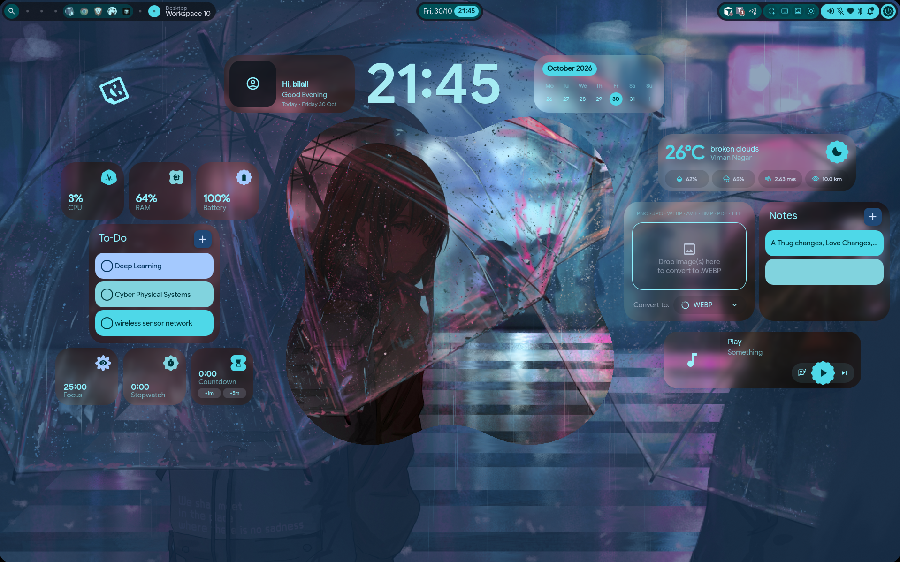

# Bilal's Hyprland dotfiles

Personal backup of an active Hyprland rice running on a 1920x1200 Wayland
display. It includes the compositor, Quickshell panels, SDDM theme selection,
terminal and launcher themes, GTK styling, scripts, wallpapers, and shell
configuration.



> This repository is a backup of one machine, not a universal installer.
> Review paths, monitor names, installed packages, and scripts before applying
> it to another system.

## Highlights

- Hyprland configuration split into Lua modules for environment, keybindings,
  rules, startup commands, variables, and services.
- Two Quickshell configurations:
  - `end4-pC` - the currently installed larger configuration.
  - `ii` - the alternate configuration retained in the live setup.
- GTK, Kvantum, Matugen, Kitty, Foot, Fuzzel, Wlogout, Btop, Cava, and
  Fastfetch styling.
- Hyprlock and Hypridle configuration.
- SDDM configuration selecting `sddm-astronaut-theme`.
- Shell dotfiles for Bash and Zsh.

## Screenshots

The [`screenshots/`](screenshots/) directory contains screenshots captured from
the live desktop. The Quickshell source also contains reference screenshots
under [`config/quickshell/end4-pC/screenshots/`](config/quickshell/end4-pC/screenshots/).

## Repository layout

```text
dotfiles/
├── config/
│   ├── hypr/                 # Hyprland, Hyprlock, and Hypridle
│   ├── quickshell/           # Quickshell configurations
│   ├── gtk-3.0/ gtk-4.0/    # GTK styling
│   ├── matugen/              # Dynamic color templates
│   ├── Kvantum/              # Qt themes
│   ├── kitty/ foot/          # Terminals
│   ├── fuzzel/ wlogout/      # Launcher and logout menu
│   ├── btop/ cava/           # Terminal visual tools
│   └── fastfetch/ nwg-look/  # Appearance utilities
├── home/                     # .bashrc, .zshrc, .zprofile, .zshenv
├── sddm/                     # SDDM theme selection and notes
├── screenshots/              # Screenshots of the live setup
├── animations/               # Existing animation presets
├── configs/                  # Existing auxiliary config presets
├── Monitor_Profiles/         # Existing monitor profiles
├── scripts/                  # Existing helper scripts
├── UserConfigs/ UserScripts/ # Existing user customizations
├── wallust/                  # Existing wallpaper color configuration
└── wallpaper_effects/        # Existing wallpaper effects
```

The `config/` and `home/` directories mirror the destination directories
without the leading dot:

```text
config/hypr/hyprland.lua       -> ~/.config/hypr/hyprland.lua
config/quickshell/end4-pC/     -> ~/.config/quickshell/end4-pC/
home/.zshrc                    -> ~/.zshrc
```

## Requirements

Recommended base:

- Arch Linux or an Arch-based distribution
- A Wayland-capable GPU and working session
- Hyprland
- Git
- A terminal

The exact package names vary by distribution. The setup references tools such
as Quickshell, Hyprlock, Hypridle, Fuzzel, Kitty, Foot, Matugen, Wlogout,
Wallust, `grim`, `slurp`, `wl-clipboard`, audio controls, and brightness
controls. Install the tools needed by the modules you enable rather than
installing every optional dependency.

On Arch Linux, a useful starting point is:

```bash
sudo pacman -Syu
sudo pacman -S --needed \
  git hyprland quickshell hyprlock hypridle \
  kitty foot fuzzel wlogout \
  grim slurp wl-clipboard \
  pipewire pipewire-pulse wireplumber \
  playerctl brightnessctl pavucontrol \
  xdg-desktop-portal-hyprland
```

Install `sddm-astronaut-theme` separately if you want the same login screen.
The theme source is intentionally not vendored in this repository.

## Quick start

Clone the repository:

```bash
git clone https://github.com/Bilalk0804/dotfiles.git
cd dotfiles
```

Before copying anything, inspect the files and compare them with your current
configuration:

```bash
find config/hypr -type f -maxdepth 4 | sort
find config/quickshell -maxdepth 2 -type f | sort | head -100
```

Back up your current files:

```bash
backup="$HOME/.config-backup-$(date +%Y%m%d-%H%M%S)"
mkdir -p "$backup"
cp -a "$HOME/.config/hypr" "$backup/" 2>/dev/null || true
cp -a "$HOME/.config/quickshell" "$backup/" 2>/dev/null || true
```

Copy the user configuration:

```bash
cp -a config/. "$HOME/.config/"
cp -a home/. "$HOME/"
```

Do not copy the SDDM file as a normal user. After installing the theme, copy
it with administrator privileges:

```bash
sudo install -Dm644 sddm/sddm.conf.d/theme.conf \
  /etc/sddm.conf.d/theme.conf
```

Log out and choose Hyprland from the SDDM session list. If Hyprland is already
running, reload it:

```bash
hyprctl reload
```

Quickshell can be started using the command appropriate to the configuration
you choose. Check the project README and your Hyprland startup module before
launching it manually:

```bash
quickshell -c end4-pC
```

If your local Quickshell version uses a different command-line format, run
`quickshell --help` and update the startup command in the Hyprland config.

## Applying only one component

You do not need to install the whole rice. Copy individual components:

```bash
# Hyprland and lock/idle configuration
cp -a config/hypr "$HOME/.config/"

# Current Quickshell configuration
cp -a config/quickshell/end4-pC "$HOME/.config/quickshell/"

# Terminal and launcher themes
cp -a config/kitty config/foot config/fuzzel "$HOME/.config/"

# GTK and Qt appearance
cp -a config/gtk-3.0 config/gtk-4.0 config/Kvantum config/matugen \
  "$HOME/.config/"
```

Copy shell files individually if you do not want to replace your complete
shell configuration:

```bash
cp home/.zshrc "$HOME/.zshrc"
cp home/.zprofile "$HOME/.zprofile"
cp home/.zshenv "$HOME/.zshenv"
```

## Configuration notes

### Hyprland

The main entry point is [`config/hypr/hyprland.lua`](config/hypr/hyprland.lua).
The supporting modules are under [`config/hypr/hyprland/`](config/hypr/hyprland/)
and [`config/hypr/custom/`](config/hypr/custom/). Review monitor and output
settings before using this on a different laptop or monitor:

```bash
hyprctl monitors
hyprctl workspaces
hyprctl clients
```

The setup also includes:

- `hyprlock.conf` and generated lock-screen colors
- `hypridle.conf`
- startup scripts and service definitions
- custom keybindings and window rules

### Quickshell

The two configurations are independent trees. Start only one unless you
intentionally want both panels:

```text
~/.config/quickshell/end4-pC/
~/.config/quickshell/ii/
```

The Quickshell weather service no longer contains the original embedded API
credential. Configure your own provider or leave weather disabled.

### SDDM

The tracked file is [`sddm/sddm.conf.d/theme.conf`](sddm/sddm.conf.d/theme.conf).
It contains only:

```ini
[Theme]
Current=sddm-astronaut-theme
```

The theme itself must be installed separately. If it is not installed, remove
or change this setting before restarting SDDM.

## Reloading and useful commands

```bash
hyprctl reload                    # Reload Hyprland configuration
hyprctl monitors                  # Show monitor names and modes
hyprctl clients                   # Show open windows
hyprctl activeworkspace           # Show the active workspace
hyprctl dispatch exec kitty       # Launch a test terminal
quickshell --help                 # Check installed Quickshell options
systemctl --user status pipewire  # Check audio service
wpctl status                      # List PipeWire devices
```

After changing a theme, restart the affected application. After changing GTK
files, log out and back in if applications do not reload their style.

## Troubleshooting

### Hyprland fails to start

Use a TTY with `Ctrl+Alt+F3`, log in, and temporarily move the configuration
out of the way:

```bash
mv "$HOME/.config/hypr" "$HOME/.config/hypr.failed"
mv "$HOME/.config-backup-YYYYMMDD-HHMMSS/hypr" "$HOME/.config/hypr"
```

Then inspect the Hyprland journal:

```bash
journalctl --user -b | grep -iE 'hypr|quickshell|wayland'
```

### A monitor is blank or incorrectly positioned

Check the monitor name with `hyprctl monitors`, then review the monitor
configuration and remove hardware-specific output rules that do not apply to
your system.

### Quickshell does not appear

Check that it is installed and run it in the foreground:

```bash
command -v quickshell
quickshell --help
```

Run the selected configuration manually and read the terminal error output.
Also check that its startup command is not being launched twice.

### Fonts or icons are missing

Install the fonts referenced by the Quickshell and GTK themes, then restart
the affected applications. The repository contains some theme assets, but it
does not replace every system font package.

### SDDM shows the wrong theme

Verify the file and theme directory:

```bash
cat /etc/sddm.conf.d/theme.conf
ls /usr/share/sddm/themes/
```

The value in `Current=` must exactly match an installed theme directory.

## Updating this repository

From the local checkout:

```bash
cd ~/dotfiles
git pull --ff-only
git status
```

To record a local configuration change:

```bash
git add config/hypr/path/to/changed-file
git commit -m "Describe the configuration change"
git push
```

Keep commits grouped by component. Never commit API keys, passwords, private
keys, browser profiles, cookies, SSH keys, or generated machine state.

## Restoring the previous setup

If you created the timestamped backup above, restore it by first moving the
new configuration aside:

```bash
mv "$HOME/.config/hypr" "$HOME/.config/hypr.dotfiles"
mv "$HOME/.config/quickshell" "$HOME/.config/quickshell.dotfiles"
cp -a "$backup/hypr" "$HOME/.config/" 2>/dev/null || true
cp -a "$backup/quickshell" "$HOME/.config/" 2>/dev/null || true
```

Then log out and start a fresh Hyprland session.

## License and attribution

This repository contains personal configuration plus third-party themes and
assets. Check the license files inside each included project before
redistributing individual assets. The repository's root license applies only
where its terms are applicable.
